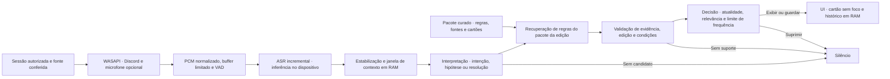

# Whisper — Arquitetura inicial

## Decisão proposta

Começar com **um aplicativo desktop modular em Windows 11 x64, executado inteiramente na máquina do mestre**. Captura, ASR, interpretação, regras, validação e interface ficam no mesmo PC. O Whisper opera sem conta, backend ou credenciais de API. O Discord continua responsável pela chamada e pela sua própria conexão. A UI usa WPF e o núcleo usa C#/.NET 10 LTS. Um adaptador WASAPI entrega o áudio do Discord e do microfone opcional. A fonte, o transcritor e o relógio podem ser trocados nos testes. A [Fase 0](ROADMAP.md) mede a integração nativa e os requisitos de hardware.

### A · Pipeline local com worker de ASR

O processo desktop coordena a sessão e contém captura, interpretação, recuperação, validação, política e UI. Um processo filho, sem interface pública de rede, carrega o modelo e recebe frames por pipes locais. O isolamento permite encerrar o ASR em caso de travamento e limita o impacto de falhas nativas na interface. Empacotar o worker, conferir arquitetura e versão no início e usar um protocolo pequeno com timestamps, tamanhos máximos e cancelamento. O app mantém um instalador e uma operação sem backend. Os custos são distribuição dos pesos, compatibilidade com hardware e manutenção de um binário nativo.

### B · Pipeline local com ASR no processo desktop

Carregar a biblioteca nativa de ASR no processo desktop e executar a inferência em uma thread de trabalho dedicada. Essa variante evita o protocolo entre processos e simplifica o empacotamento. A contrapartida é que uma falha nativa pode derrubar o aplicativo inteiro, e o host perde a possibilidade de encerrar apenas o ASR se uma chamada nativa travar. A interface de segmentos e a política de filas continuam as mesmas. Comparar o impacto das duas variantes com o mesmo modelo e hardware para separar custo de comunicação de custo de inferência. [Infraestrutura e custo por hora](TECHNICAL_RESEARCH.md#infraestrutura-e-custo-por-hora)

**Critério de escolha.** A é a recomendação pelo isolamento de falhas e pela capacidade de reiniciar a inferência sem encerrar o aplicativo. Testar B se o empacotamento ou a comunicação entre processos criar um custo material medido. Se o gargalo for inferência, ajustar modelo, janelas e concorrência. Comparar Vosk e aceleração no próprio dispositivo antes de rever o hardware mínimo. Se a falha estiver na relevância, iterar com segmentos rotulados.

## Fluxo de dados

## Componentes e fronteiras

1. **Controlador de sessão.** Fonte de verdade para estado, consentimento e versão do pacote. Estados mínimos são inativo, conferência da fonte, escutando, pausado, degradado e encerrando. Cada início ou retomada cria uma geração de processamento. Tarefas carregam o identificador dessa geração e a UI rejeita resultados da geração anterior. Alterar edição durante uma sessão requer encerrar e iniciar outra.
2. **Captura e normalização.** Threads de captura enfileiram frames sem esperar pelo ASR. Carregar origem, número de sequência, timestamp monotônico, duração e sinalização de descontinuidade. Converter para PCM mono de 16 kHz por origem no adaptador e manter metadados de qualidade. Usar duas origens quando o microfone estiver habilitado. Aferir drift, eco e duplicatas na bancada. A prévia de fonte alimenta somente os medidores.
3. **Transcrição.** A fila de áudio tem limite inicial de 4 s de trabalho ainda não consumido por origem. Se exceder o limite, descartar trabalho antigo, emitir lacuna e invalidar interpretações que dependam do trecho. O worker usa VAD, janelas sobrepostas curtas e tempo máximo por trabalho. Entregar ID, origem, intervalo, texto, status parcial/estável e sinais de qualidade quando disponíveis. Estabilizar transições entre janelas por intervalo e sobreposição textual. Provedores podem oferecer scores diferentes. Calibrá-los separadamente e aceitar “desconhecido”.
4. **Contexto e interpretação.** Manter até 45 s de segmentos estáveis em RAM, limitados também por volume de texto, com uma janela curta de revisão do evento. Extrair família mecânica e tipo de enunciado por léxico, padrões de intenção e sinais de veto. Exigir evidência por intervalo, reavaliar correções e registrar lacunas. Pergunta mecânica do mestre pode ser candidata quando sua origem for conhecida. Uma hipótese de jogador, uma negação e uma ação já resolvida produzem silêncio. Quando o papel depende de identificar uma voz no áudio misturado, abster-se. Eventos têm ID, intervalo, categoria, intenção, origem e lacunas. Nenhum evento de intenção altera estado ficcional.
5. **Pacote e recuperação.** Carregar JSON empacotado e validado, indexar em RAM por categoria e aliases PT-BR/EN. O pacote tem `systemId`, edição, versão, idioma, versão de esquema, manifesto de fontes e entradas com ID estável, tópico, condições, exceções, referência e cartões revisados. Cada fonte tem título, autor, URL, seção ou página, versão, licença, atribuição e indicação de adaptação. Um novo pacote é conteúdo declarativo. Se exigir interpretação própria, adicionar um módulo testado após validar o segundo sistema.
6. **Validação.** Checar edição, referência, evidência do evento, condições exigidas e exceções. Um cartão genérico pode lembrar uma regra quando falta um dado da ficha, desde que sua redação deixe a condição explícita. Se uma aplicação concreta depender do dado ausente, suprimir a aplicação. Usar texto curado e parâmetros tipados, sem completar CDs, condições ou efeitos. Se houver um classificador por LLM no futuro, aceitar apenas tipos e evidências válidos, sem ferramentas nem capacidade de publicar.
7. **Política e composição.** Avaliar atualidade, interrupções, utilidade esperada e resolução já observada. Proposta inicial de validade de 6 s desde o fim da evidência, deduplicação da mesma regra e evento por 60 s, intervalo mínimo de 90 s entre popups e teto de 4 em janela móvel de 1 h. O perfil conservador reduz o teto para 2/h. Silencioso guarda cartões no histórico sem abrir popup. A UI recebe somente o cartão validado. O popup dura cerca de 8 s, sem som e sem ativação. O histórico guarda no máximo 20 cartões da sessão. Limiares são hipóteses a calibrar em amostra separada.

Os componentes de domínio se comunicam em processo por tipos simples e canais limitados. A fronteira com o worker leva áudio e segmentos por pipes locais restritos ao usuário e à instância do app. Na variante B, esses dados circulam por filas em memória. O cartão é renderizado com dados locais e o link da fonte só é aberto mediante ação do mestre.

## Persistência, segurança e falhas

- **Em disco.** Preferências não sensíveis, pacote oficial, modelo e binários verificáveis, com versão, checksum do artefato de origem e avisos de licença. Permitir instalação e troca de modelo por artefato local verificado. O runtime não persiste áudio, transcrição ou cartões. SQLite entra quando a busca ou persistência estruturada justificar seu custo.
- **Em memória.** Áudio, trechos de contexto, candidatos e histórico têm capacidade e prazo. Ao pausar, fechar fontes e conexão de ASR, invalidar a geração, descartar filas e limpar contexto e medidores. Cartões já entregues podem ficar até exclusão ou encerramento. Ao encerrar, limpar também histórico e deduplicação. Crash dumps e paginação podem conter memória. Desabilitar coleta de dumps pelo app, inspecionar os caminhos de diagnóstico e explicitar o alcance do descarte em RAM no aviso do piloto.
- **Falhas de origem.** PID trocado, dispositivo inválido, permissão bloqueada ou suspensão invalidam a geração. Exibir ação de recuperação e exigir conferência antes de retomar. Ausência de voz pode ser normal. Usar estado do processo/dispositivo e teste de fonte para distinguir falha conhecida de uma pausa na conversa.
- **Falhas de ASR.** Worker sem resposta, modelo indisponível e saturação geram lacuna e status discreto. Invalidar candidatos afetados, limitar retentativas locais com backoff e pausar se a falha persistir. Após recuperação, descartar o backlog e processar apenas áudio novo de uma fonte revalidada.
- **Falhas de pacote.** Validar versão, esquema e integridade no início. Uma entrada sem referência é inelegível. Se o pacote inteiro estiver incompatível, bloquear o início e orientar recuperação. Manter a última versão válida até que uma atualização tenha sido verificada. Em eventual importação de regras caseiras, limitar tamanho e tratar texto e links como dados.
- **Privacidade visual.** Usar janela do próprio app, sem notificações no sistema, mensagens no Discord ou som. Testar foco, monitores, DPI e compartilhamento. A exclusão de janela da captura do Windows pode complementar o controle manual, com cobertura dependente do método de captura. [SetWindowDisplayAffinity](https://learn.microsoft.com/en-us/windows/win32/api/winuser/nf-winuser-setwindowdisplayaffinity)
- **Diagnóstico.** Contadores e histogramas locais sem texto ou áudio para latência, filas, fontes, falhas e motivos de supressão. Exportação de arquivo somente no piloto, por ação do mestre, com campos inspecionáveis.

## Extensão e testes

Uma regra caseira futura é um overlay por pacote, com substituição declarada, rótulo próprio e regressões de precedência. Uma memória futura separa hipótese, fato confirmado e correção. Condições e temporizadores dependem de confirmação do mestre ou de uma fonte estruturada confiável, como um VTT autorizado. Evitar estimar duração de efeito a partir da transcrição solta.

Usar replay determinístico de segmentos com relógio controlado para testar interpretação, regras, política e deduplicação. Replay de áudio testa o ASR e suas revisões. Testes de integração no Windows cobrem fonte, dispositivos, exclusão, filas e perda do worker. A UI é aferida em sessão simulada com janela em foco e compartilhamento. Guardar fixtures sintéticas no repositório e material de sessões reais consentidas em ambiente separado com acesso e prazo definidos. [Métricas e protocolo do piloto](MVP_SCOPE.md)
